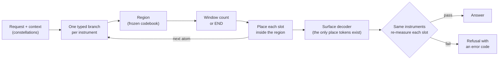
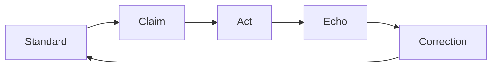

<p align="center">
  
</p>

<h3 align="center">A language model that predicts the next <i>meaning</i>, not the next token.</h3>

<p align="center">
  <a href="#1--tokens-are-symbols-meaning-is-measured">How it works</a> ·
  <a href="#7--jesus-is-king">Jesus Is King</a> ·
  <a href="#where-it-stands">Where it stands</a> ·
  <a href="#citing">Citing</a>
</p>

<p align="center">
  
  
  
</p>

**JIK** (Jesus Is King) is a from-scratch *meaning-native language model* (MNLM) and the
**Meaning Base** it learns from. Every unit of text is measured by several frozen instruments,
each one a separate sense. The model learns over those typed measurements. Text appears only
at the very end, and the same instruments check it before it leaves. A slot that fails its
check becomes a refusal, not a guess. Its fixed standard is the teachings of Jesus of Nazareth,
built into the model's own learning loop rather than added as a filter.

> [!NOTE]
> This is active research, not a usable model. The pipeline runs end to end at full corpus
> scale, but output quality does not yet beat simple baselines on most tasks. Every number
> below is measured from persisted bytes and checked by the session that produced it; none
> has been independently replicated yet. See [Where it stands](#where-it-stands).

---

## 1 · Tokens are symbols. Meaning is measured.


Every language model today learns to continue strings of symbols. Its knowledge of what
those symbols *mean* is only implied by its weights, and it has no built-in way to say
"I don't know."

JIK changes what the model learns from. Text is cut into **atoms**: a sentence, a code unit, a
docket entry, a frame window. Each atom keeps its exact source bytes and its place in the
sentence, paragraph and page it came from. The model never sees a token sequence. It sees each
atom as a **constellation**: one typed reading from every instrument that measured it.

## 2 · Several senses, never blended


An instrument is a frozen, hash-pinned embedder. Each reads the same atom in its own way, and
its reading stays in its own **slot**. Slots are never averaged or concatenated into one
vector. The current text panel has six instruments (MPNet, CodeBERT, E5, FinBERT, PubMedBERT,
SPECTER2); audio and vision each have five candidates.

An instrument only counts as a **sense** once it passes a contract that is never tuned toward
a result:

| Gate | Rule |
|---|---|
| **Adds information** | ≥ 0.05 bits about a grounded outcome, conditional on the rest of the panel, measured in chunks with the Calyx `bits` method |
| **Measures differently** | correlation ≤ 0.6 with every other admitted sense |
| **Is fixed** | frozen and hash-pinned; a different runtime is a different instrument |
| **Enough senses** | a meaning is asserted only when ≥ 5 admitted senses read that atom |

A caption cannot stand in for sight, and a transcript cannot stand in for hearing. Text can
report an event without showing that it happened.

## 3 · A memory of associations


The Meaning Base turns real sources into measured, deduplicated, provenance-sealed atoms. The
current full-scale corpus is a set of Ohio legal records. Every original byte can be
rebuilt from its atoms, and the corpus is split by case before any fitting, so no related
document crosses from training into evaluation.


Each sense gets its own association graph. A path through the graph remembers which instrument
made each hop, so the model can see that two atoms are close to one sense and far apart to
another. The small **kernel** of that graph is what the model trains on. A kernel is accepted
only if held-out recall is at least 0.95.

## 4 · From meaning to an answer


The model reads a request and its context as constellations, then builds its answer one atom
at a time. For each atom it does three things:

1. **Measure**: pick the region of meaning the next atom belongs to, from a frozen codebook.
2. **Count**: decide how many native windows the atom needs, or that the answer is finished.
3. **Compose**: place every sense's slot inside that region.



Tokens exist only inside the surface decoder at the end. No pretrained generative LLM is used
anywhere: not as a sense, a judge, a teacher or a component.

## 5 · A refusal, not a guess


The output is re-measured by the same instruments that read the input. If a slot lands outside
the region it was supposed to be in, the answer stops there with an actionable error code. A
slot regressed without a region is the average of several meanings, and the average of
meanings is not itself a meaning.

## 6 · Every claim is weighed and replayed


A result counts only if it beats the controls: shuffled context, reversed order, copy the
current atom, and trivial rules such as "one atom, then stop." Every number is tagged
*measured* (read back from persisted bytes) or *projected*, and a projection never becomes a
result by repetition.


Every training run is replayed by a separate cold process started from the saved bytes. It
must reproduce the weights, gradients and optimizer state exactly, not just the final score.
Failed runs stay on record next to their fixes. The system fails closed: no mock data, no
fallback success, and no silent switch from GPU to CPU.

## 7 · Jesus Is King


JIK's standard is the teachings and conduct of Jesus of Nazareth, across the whole admitted
scripture reference set. It is applied through the **Identity Loop** from *Reading the Loop*
(Royse, 2026), whose five phases live inside the model's recurrent state and training
objectives, not in a prompt or an output filter:



Many loops run at once, one per task, relationship or question. They share the same fixed
standard and stay separate across delayed feedback and restarts. The standard does not move;
beliefs about the world stay open to correction. JIK always identifies itself honestly as an
AI.

## Where it stands


*Snapshot of 24 October 2026. All figures measured and author-checked; not yet independently replicated.*

| | What it can do |
|---|---|
| **Works** | Take in a 115,053-record legal corpus (8.19 million atoms) without loss, split by case with no leakage. |
| | Read all 6.36 million distinct inputs with six instruments and prove every reading from the stored bytes. |
| | Build six full association graphs (381.6 million typed edges) and walk typed evidence paths. |
| | Train a region codebook on the full training split without collapse (13–33 % better reconstruction than constant baselines). |
| | Generate a complete answer one constellation at a time and decide on its own when to stop (up to 132 of 170 held-out tasks). |
| | Replay any training run exactly in a cold process; train on documents of 3,210 atoms within memory. |
| **Partly** | Single-atom reasoning answers beat both copy and shuffled-context baselines on every sense. Longer answers do not yet. |
| | Broader data beats repeated data by 10.9 points of region accuracy, but region prediction (37.1 %) is still below copy-the-current-atom (40.8 %). |
| **Not yet** | Render valid free text from predicted slots. |
| | Hold quality when reading its own generated output. |
| | Admit any instrument as a sense under the contract above. Until five pass, no meaning is asserted. |
| | Calibrate the output guard; learn the Identity Loop inside the model. |

**Next:** full-length answer training over the whole legal corpus with matched controls; a
fair, capacity-matched comparison of three predictor designs; a calibrated per-slot guard;
sense admission; then audio and vision in learning, and the full continuous-learning cycle
the project is building toward.

## Repository map

| Path | What is there |
|---|---|
| [`AGENTS.md`](AGENTS.md) | The binding operating rules for every contributor, human or agent |
| `scripts/census`, `scripts/canon` | Stages 0–2: source ledger, deduplication, atomisation |
| `scripts/lens`, `scripts/senses`, `scripts/text` | Instruments, native measurement, the Calyx `bits` port |
| `scripts/kernel` | Association graphs and recall-gated kernels |
| `scripts/model` | Typed branches, region predictor, placement, surface decoder, guard |
| `scripts/audit` | Full State Verification: independent readback and cold replay |
| `config/` | Pinned sources, instrument panels, identity profile |

Code and error codes use the `MNLM_` prefix, the name of the method. JIK is the model.

## Working in this repository

All training and measurement run on one dedicated GPU host, one job at a time under a lease
file; the workstation only edits code. Install the tracked git guards once per clone:

```powershell
powershell -NoProfile -ExecutionPolicy Bypass -File scripts\install-mnlm-git-guards.ps1
```

Before claiming a result, apply **Full State Verification**: name the persisted source of
truth, run the real path, read the state back independently, and audit at least three
boundaries with before, action and after evidence and with negative controls. Say
*author-checked* for your own readback; *verified* is reserved for independent replication.

<details>
<summary><b>Glossary</b></summary>

- **Atom**: the smallest independently measured unit (sentence, code unit, docket entry, frame window).
- **Instrument / lens**: a frozen, hash-pinned embedder. It becomes a **sense** only after admission.
- **Slot**: one instrument's reading of one atom.
- **Constellation**: an atom's set of typed slots, kept separate.
- **Region**: a cell of the frozen semantic-ID codebook. The model picks a region before placing slots.
- **Kernel**: the small part of the association graph the model trains on, from which the rest is recoverable (held-out recall ≥ 0.95).
- **Anchor**: a grounded outcome, such as a passing test or a verified fact, used to score instruments in bits.
- **Cold replay**: a fresh process rebuilds a run from saved bytes and must match it exactly.

</details>

## Citing

```bibtex
@misc{royse2026meaningbase,
  author = {Royse, Chris},
  title  = {The Meaning Base: Re-Issuing the Public Token Stock as Grounded Constellations
            and Training the Smallest Capable Model on Its Kernel},
  year   = {2026},
  month  = oct,
  note   = {Working paper, draft v1.0}
}
```

## Licence

No licence has been chosen yet, so all rights are reserved by the author. Third-party corpora
and model weights are referenced by pinned revision and keep their own licences; none are
redistributed here.
